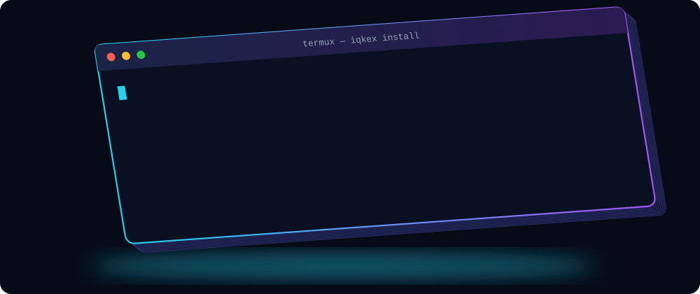
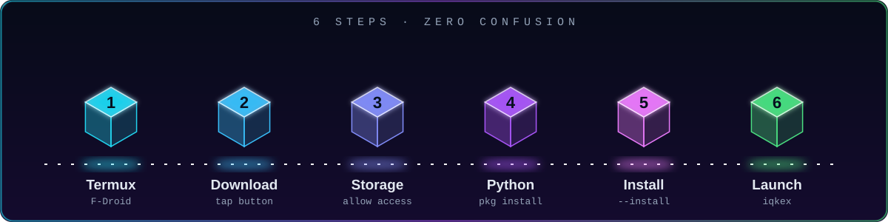
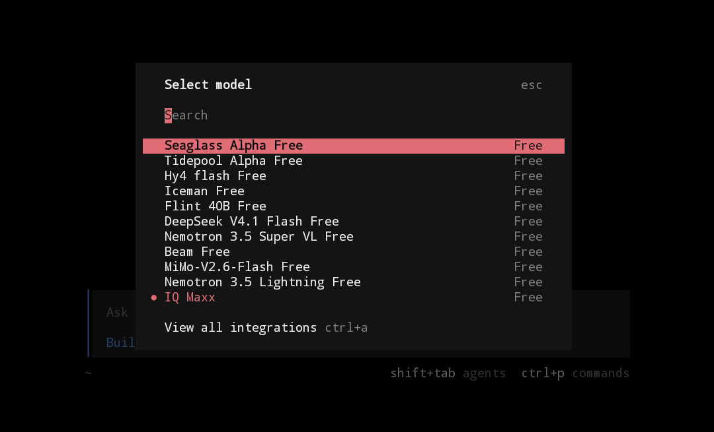

<p align="center">
  
</p>

<h1 align="center">IQKEX for Android</h1>

<p align="center"><strong>A practical installation guide for Android + Termux</strong></p>

<p align="center">
  
  
  
</p>

<p align="center">
  
  
  
</p>

<p align="center">
  <a href="#quick-start">Quick start</a> &nbsp;·&nbsp;
  <a href="#screenshots">Screenshots</a> &nbsp;·&nbsp;
  <a href="#video-guides">Video guides</a> &nbsp;·&nbsp;
  <a href="#storage-and-safety">Storage &amp; safety</a>
</p>

<p align="center"></p>

## Quick start

> [!WARNING]
> The original guide recommends **more than 40 GB of free storage**. Please read [Storage and safety](#storage-and-safety) before installing.

<p align="center">
  <a href="https://dl.dropboxusercontent.com/scl/fi/s8zz1ixgkhfsctsj0w046/Iqkex-android.pyz?rlkey=kjqpm731poyt4ls5tzta2ue16&st=909znxa4&dl=1">
    
  </a>
</p>

<p align="center"><strong>Tap the large green button — the download starts immediately.</strong></p>

The downloaded package is named `iqkex-android.pyz`. Only download and run it if you trust its source.

### Watch the setup

<p align="center">
  
</p>

<p align="center">
  
</p>

<details>
<summary><strong>🧠 AI core — click to peek</strong></summary>

```text
   INPUT          HIDDEN LAYERS          OUTPUT
    (●)────┬──────(●)────(●)─────┬──────(●)
    (●)────┼──┬───(●)────(●)─────┼──┬───(●)
    (●)────┴──┼───(●)────(●)─────┴──┼───(●)
    (●)───────┴───(●)────(●)────────┴───(●)
     0101  →  think()  →  code()  →  run()
```

</details>

### At a glance

|  | Step | What to do |
|:---:|:---:|---|
| 01 | Prepare | Install Termux from [F-Droid](https://f-droid.org/packages/com.termux/) |
| 02 | Download | Tap the green button — the package downloads straight to your Downloads folder |
| 03 | Storage | Open Termux, allow storage access and enter the Downloads folder |
| 04 | Set up | Update Termux and install Python |
| 05 | Install | Run the IQkex installer |
| 06 | Launch | Enter `iqkex` |

<p align="center"></p>

## Prewiew The IQkex Interface

<p align="center">
  
</p>

<p align="center">
  
</p>

<p align="center"></p>

## Installation && Setup

Run the commands below **in order**, exactly as shown. Nothing else needs to be renamed or moved.

### 1 · Install Termux

Install Termux from [F-Droid](https://f-droid.org/packages/com.termux/). The original guide advises against the Play Store version.

### 2 · Download IQkex

Tap the green **CLICK TO DOWNLOAD** button in [Quick start](#quick-start). The download starts immediately and the package is saved straight into your phone's **Downloads** folder.

Wait until the download has finished before moving on.

### 3 · Allow storage access

Open Termux and run:

```bash
termux-setup-storage
```

Tap **Allow** on the permission request, then go into your Downloads folder:

```bash
cd ~/storage/downloads
```

### 4 · Update Termux and install Python

```bash
pkg update -y && pkg upgrade -y
pkg install python -y
```

If Termux asks any question during the update, press **Enter** to accept the default.

### 5 · Install IQkex

You are already in `Downloads`, so run the installer directly:

```bash
python "$(ls -t [Ii]qkex-android*.pyz | head -n 1)" --install
```

This command automatically picks the newest downloaded IQkex package, so it works even if your browser saved the file as `iqkex-android (1).pyz` or with a capital `I`.

Keep Termux open until installation finishes. You may see:

```text
[ iqkex ]  unpacking core..
```

### 6 · Launch IQkex

```bash
iqkex
```

To start it again later, open Termux and enter `iqkex`.

<p align="center"></p>

## Video guides

<p align="center">
  <a href="https://www.instagram.com/reel/Dfeb4OAualp/?jplx=MWFheXMzaXo1cm5icg==">
    
  </a>
</p>

<p align="center">
  <a href="https://youtube.com/shorts/O65LHvRbOKQ?si=zVCku1qFCYxTvYjW">
    
  </a>
</p>

## Uninstall

Run these commands in Termux, in order, to remove IQkex completely.

**1 · Remove the launcher and the extracted core**

```bash
rm -f "$PREFIX/bin/iqkex"
rm -f "$PREFIX/lib/iqkex/iqkex.linux-aarch64"
rmdir "$PREFIX/lib/iqkex" 2>/dev/null
```

**2 · Delete the downloaded package from Downloads**

```bash
rm -f ~/storage/downloads/[Ii]qkex-android*.pyz
```

**3 · Check that it is gone**

```bash
command -v iqkex || echo "IQkex removed"
```

**4 · Optional: remove Python**

Only do this if you no longer need Python in Termux for anything else:

```bash
pkg uninstall python -y
```

To wipe everything Termux holds (all packages and files saved inside Termux), see [Storage and safety](#storage-and-safety).

## Troubleshooting

<details>
<summary><strong>Something went wrong? Click to open the fixes</strong></summary>

| Problem | Fix |
|---|---|
| `No such file or directory` when running `cd ~/storage/downloads` | Run `termux-setup-storage` again and tap **Allow**, then retry. |
| `ls: cannot access '[Ii]qkex-android*.pyz'` | The download has not finished or is not in Downloads. Check with `ls ~/storage/downloads` and download again if needed. |
| `python: command not found` | Run `pkg install python -y`, then repeat the install step. |
| `iqkex: command not found` after installing | Close Termux completely, reopen it, and enter `iqkex` again. |
| The install was interrupted | Run the install command from step 5 again. |

</details>

## Storage and safety

IQkex may install many packages and create cache files, so storage use can grow over time. The original guide recommends not installing it on a phone with less than **40 GB free**.

To clear Termux data, open the app's **App info** page and choose **Clear data**. This removes Termux, Python, IQkex, installed packages, and files saved inside Termux. Back up anything important first. If you only need to free a small amount of space, try **Clear cache** instead.

<p align="center"></p>

<p align="center"><sub>© 2026 S DEEPAK KUMAR / IQ MAXX · All rights reserved</sub></p>

<p align="center"><a href="#top">⬆ Back to top</a></p>
