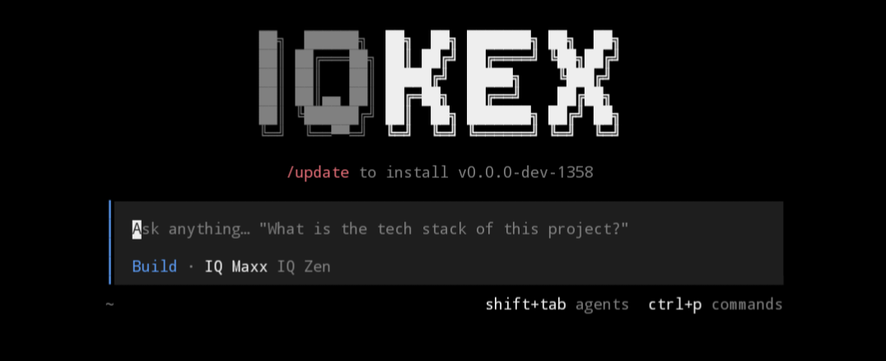

<p align="center">
  
</p>

<h1 align="center">IQKEX for Android</h1>

<p align="center"><strong>A practical installation guide for Android + Termux</strong></p>

<p align="center">
  
  
  
</p>

<p align="center">
  <a href="#quick-start">Quick start</a> &nbsp;·&nbsp;
  <a href="#screenshots">Screenshots</a> &nbsp;·&nbsp;
  <a href="#video-guides">Video guides</a> &nbsp;·&nbsp;
  <a href="#storage-and-safety">Storage &amp; safety</a>
</p>

---

## Quick start

> [!WARNING]
> The original guide recommends **more than 40 GB of free storage**. Please read [Storage and safety](#storage-and-safety) before installing.

<p align="center">
  <a href="https://dl.dropboxusercontent.com/scl/fi/s8zz1ixgkhfsctsj0w046/Iqkex-android.pyz?rlkey=kjqpm731poyt4ls5tzta2ue16&st=909znxa4&dl=1">
    
  </a>
</p>

<p align="center"><strong>Tap the large green button — the download starts immediately.</strong></p>

The downloaded package is named `Iqkex-android.pyz`. Only download and run it if you trust its source.

### At a glance

|  | Step | What to do |
|:---:|:---:|---|
| 01 | Prepare | Install Termux from [F-Droid](https://f-droid.org/packages/com.termux/) |
| 02 | Download | Save `Iqkex-android.pyz` to Downloads |
| 03 | Set up | Grant storage access, update packages, install Python |
| 04 | Install | Run the IQkex installer in Termux |
| 05 | Launch | Enter `iqkex` |

---

## Prewiew The IQkex Interface

<p align="center">
  
</p>

<p align="center">
  
</p>

<p align="center"><sub>Place your original screenshots in <code>assets/</code> with the filenames shown above.</sub></p>

---

## Installation && Setup

### 1 · Install Termux

Install Termux from [F-Droid](https://f-droid.org/packages/com.termux/). The original guide advises against the Play Store version.

### 2 · Allow storage access

Open Termux and run:

```bash
termux-setup-storage
```

Allow the permission request, then go to your Downloads folder:

```bash
cd storage
cd Downloads
```

### 3 · Update Termux and install Python

```bash
pkg update && pkg upgrade
pkg install python
```

If Termux asks you to continue, enter `y` and press **Enter**.

### 4 · Install IQkex

If the downloaded file is directly in `Downloads`, create a folder and move the package into it:

```bash
mkdir -p iqkex && mv Iqkex-android.pyz iqkex/
cd iqkex
```

Run the installer:

```bash
python Iqkex-android.pyz --install
```

Keep Termux open until installation finishes. You may see:

```text
[ iqkex ]  unpacking core..
```

### 5 · Launch IQkex

```bash
iqkex
```

---

## Video guides

<p align="center">
  <a href="https://www.instagram.com/reel/Dfeb4OAualp/?jplx=MWFheXMzaXo1cm5icg==">
    
  </a>
</p>

<p align="center">
  <a href="https://youtube.com/shorts/O65LHvRbOKQ?si=zVCku1qFCYxTvYjW">
    
  </a>
</p>

## Uninstall

Run these commands in Termux to remove the launcher and extracted core:

```bash
rm -f "$PREFIX/bin/iqkex"
rm -f "$PREFIX/lib/iqkex/iqkex.linux-aarch64"
rmdir "$PREFIX/lib/iqkex" 2>/dev/null
```

## Storage and safety

IQkex may install many packages and create cache files, so storage use can grow over time. The original guide recommends not installing it on a phone with less than **40 GB free**.

To clear Termux data, open the app's **App info** page and choose **Clear data**. This removes Termux, Python, IQkex, installed packages, and files saved inside Termux. Back up anything important first. If you only need to free a small amount of space, try **Clear cache** instead.

---

<p align="center"><sub>© 2026 S DEEPAK KUMAR / IQ MAXX · All rights reserved</sub></p>
